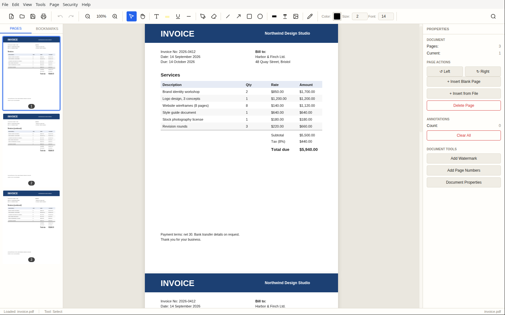
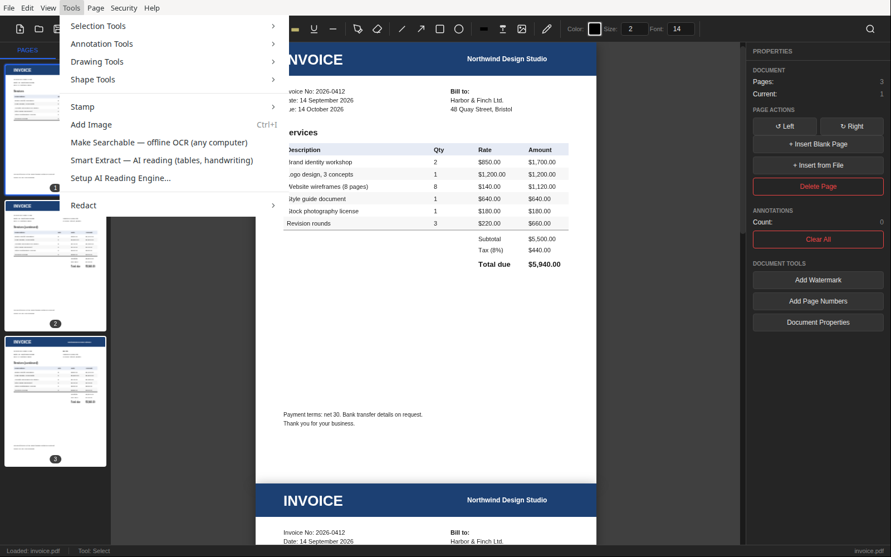
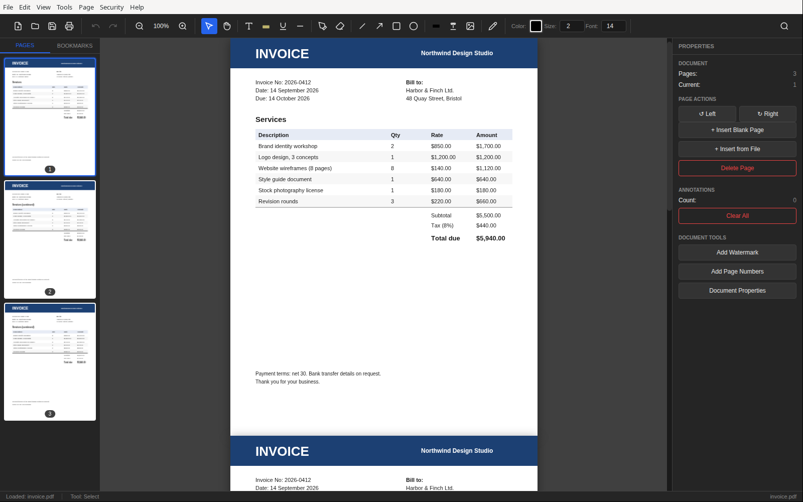

# Pagewise

**Private PDF editor that reads your documents with local AI.**



## Why Pagewise

- **Offline AI reading.** Read Tables & Handwriting runs a local `dots.ocr` vision model through llama.cpp and transcribes pages to Markdown, including tables, formulas and handwriting. Output quality depends on the document and model.
- **Nothing leaves your machine.** Editing, OCR and AI extraction run locally; page images go only to a server bound to `127.0.0.1`.
- **No accounts, subscriptions or telemetry.** Internet access is needed only to install dependencies, download OCR language data on first use, and install the optional AI reading model. After that, document processing works offline.
- **Free and MIT licensed.**

## Features

- **Open images as PDFs:** open or drop PNG/JPEG photos, screenshots and scans; each image becomes a page (phone-photo rotation is applied), ready for OCR, Read Tables & Handwriting and editing. Saving writes a new PDF and never overwrites the images.
- **Read and search:** thumbnails, zoom, selectable text, find, a clickable bookmarks panel (the document outline) and printing.
- **Find and replace:** *Edit → Find & Replace* (Ctrl+H) changes text in the page itself: the old characters are removed from the content stream (not covered with a white box), so they can no longer be copied or searched, and the rest of the line stays where it was. Replacements use the PDF's own font when it has the letters, otherwise Helvetica, Times or Courier; replacing is undoable, works on text a PDF viewer can read (not scans), and breaks a digital signature (it asks first).
- **Edit and annotate:** text, highlights, underline, strikethrough, pen, shapes, stamps, images, signatures and initials (drawn, typed or uploaded, saved for reuse, movable and resizable once placed; **Forms > Sign Document...** finds the signature lines in a form and dates them) and sticky notes. Highlights, underlines, strikethroughs and notes are saved as real PDF comments that Acrobat, Preview, Okular and browsers show as comments. The **Comments** sidebar tab lists every comment in the file by page (author, date, text or the text it covers), with search, an Open/Completed filter, replies, edit, delete and *Mark Completed*; the name on new comments is set there. Other annotations are baked into the PDF on save.
- **Organize pages:** drag to reorder, rotate one or all pages, insert blank pages or pages from another PDF or image, replace a page with one from another PDF, crop (hides content, doesn't delete it), resize pages to A4/Letter/Legal/A5, extract and delete.
- **Reduce file size:** *File → Reduce File Size...* downsamples and re-encodes large images (Smallest, Balanced or High quality); text and vector graphics are untouched.
- **Document tools:** merge, split by page count or ranges, add page numbers, headers, footers and watermarks; export pages as PNG/JPEG.
- **Fill forms:** click fields in a fillable PDF and type; values save as real form data, and *Forms → Flatten Form (make answers permanent)* makes them fixed page content. *Forms → Detect Fields Automatically* finds the blank lines and boxes on a flat or scanned form and turns them into real fields, with no AI model involved. *Forms → Add Field* adds a text field, checkbox or dropdown by hand (named after the printed text beside it), *Move & Resize Fields* drags and resizes the fields on the page, and right-clicking a field offers *Field Properties* (name, multi-line, max length, comb, font size, read-only, required, dropdown options). *Forms → Manage Profiles...* stores one or more profiles (your name, address and so on, for example one for you and one for your spouse) on this computer, encrypted when the system keyring is available, and *Fill from Profile* proposes matching values for you to review before anything is written; pick which profile to fill as and, optionally, a spouse profile for fields about the spouse. SSN and date of birth stay unticked, and fields about other people are skipped. For fields the rules leave empty, *Suggest the rest with AI* uses an optional local model (one-time 4.1 GB download, runs on the CPU, nothing leaves the computer); its suggestions are never pre-ticked, labels that try to give the AI instructions are never sent to it, and `npm run eval:writer -- --model <file.gguf>` scores a candidate model on the same prompts. To avoid typing a profile by hand, *Forms → Save Filled Answers to a Profile* turns the values in a filled form into details to review, and *Forms → Create Profile from This Document* reads an ID card, bill or letter (scanned pages go through Read Tables & Handwriting) with the local model; both end in a review dialog and nothing is saved until you click Save.
- **AI writing helper (optional):** a second download (about 4.1 GB, runs on the CPU) used by *Suggest the rest with AI* in *Forms → Fill from Profile* and by *Create Profile from This Document*; suggestions are always reviewed before anything is filled. *Remove AI Model* in the download dialog deletes both AI downloads.
- **Ask the assistant (optional):** *Help → Ask the Assistant...* (Ctrl+Shift+A) or the toolbar *Ask* button opens a chat. *How do I...* answers from the user guide with the built-in AI writing helper and adds buttons that open the menu items it names (only menu items, never anything from a document). *This page*, *Selection* and *Whole document* answer only from the PDF's own text (with the built-in model, *This page* also looks at the page image, so scans work, flagged as unchecked) and highlight the quotes they could verify; document text is treated as data, never as instructions. Answers stream in, can be stopped, and nothing leaves the computer unless you point the assistant at your own model server (any OpenAI-compatible `/v1/chat/completions`, such as llama-server) with the pencil next to *Model*; a server that is not on this computer needs an explicit confirmation. `node scripts/eval-assistant.cjs --model <file.gguf> --bin <llama-server>` scores a model on the benchmark in `tests/fixtures/assistant-eval.json`.
- **Protect documents:** AES-256 password protection and decryption.
- **Recognize Text (fast, built-in):** *Tools → Scanned Pages* runs local Tesseract OCR adds an invisible text layer at recognized word positions.
- **Redact:** marked regions are masked and the entire output PDF is rebuilt from rendered images, removing the original content and hidden objects.
- **Read Tables & Handwriting with AI (optional):** *Tools → Scanned Pages*; the local `dots.ocr` vision-language model transcribes a page into Markdown, including tables, formulas and handwriting. Output quality depends on the document and model.
- **Recognize Text with AI (optional):** *Tools → Scanned Pages* uses the same AI reading model to read hard scans (faxes, shadowed photos) and adds an invisible text layer, placing each word with Tesseract's box where it matches and an estimate from the page image otherwise.
- **Tables to spreadsheets:** export the tables Read Tables & Handwriting finds as CSV, or copy them straight into Excel or Google Sheets. A table that continues onto the next page with a repeated header is exported as one table, and cells that a spreadsheet would run as formulas are neutralized. The transcript can be saved as Markdown.
- **Export to Word and Excel:** *File → Export → Word Document (.docx)* converts digital pages locally (headings, bold, lists) and scanned pages, or every page if you tick the AI option, through Read Tables & Handwriting, with real Word tables; *Excel Workbook (.xlsx)* writes one sheet per table Read Tables & Handwriting finds. Both are written by Pagewise itself, and spreadsheet cells are never formulas.
- **Desktop conveniences:** light/dark themes, recent files, last-document restore and unsaved-change prompts.

Text replacement covers the original text with a white rectangle and adds new text; it does not remove the underlying text or reflow paragraphs. Use **Redact** for sensitive content. Applying redactions flattens **every page**, removing existing selectable text, interactive forms, links, bookmarks, attachments and source metadata. Keep an original copy if you need those features.





## Quick start

**Download** the latest build from the [Releases](https://github.com/arie-s/pagewise/releases) page:

| Platform | File |
|---|---|
| Windows x64 | `Pagewise.Setup.<version>.exe` (installer) or `Pagewise.<version>.exe` (portable) |
| macOS Apple Silicon | `Pagewise-<version>-arm64.dmg` |
| macOS Intel | `Pagewise-<version>.dmg` |
| Linux x64 | `Pagewise-<version>.AppImage` or `pagewise_<version>_amd64.deb` |

The builds are not code-signed yet. On Windows, SmartScreen may show "Windows protected your PC": choose **More info**, then **Run anyway**. On macOS, open the app once, then allow it under **System Settings > Privacy & Security > Open Anyway**. Windows and macOS builds pass automated checks in CI but have had limited hands-on testing; please open an issue if something doesn't work.

**Run from source** (Node.js 24 or newer, and Git):

```sh
git clone https://github.com/arie-s/pagewise.git
cd pagewise
npm ci
npm start
```

Linux needs a graphical desktop and Electron's system libraries. To build installers for Windows, Linux or macOS, set up the AI reading model, or troubleshoot AppImage/FUSE issues, see [docs/INSTALL.md](docs/INSTALL.md). It also covers removing the AI reading model and uninstalling.

## CLI

```sh
npm run cli -- merge out.pdf a.pdf b.pdf c.pdf
npm run cli -- split doc.pdf --ranges 1-3,5,7-10
npm run cli -- encrypt doc.pdf --password secret --out protected.pdf
npm run cli -- info doc.pdf
npm run cli -- engine-extract page.png --prompt "Convert the document to markdown."
npm run cli -- engine-extract invoice.png --csv invoice.csv
npm run cli -- extract receipts/ --out results --csv all-tables.csv --skip-existing
```

Commands: `merge`, `split`, `encrypt`, `decrypt`, `info`, `engine-install`, `engine-start`, `engine-stop`, `engine-remove`, `engine-extract`, `extract` (batch: PDFs, PNG/JPEG images or folders in, one Markdown file and CSVs per document out). A packaged app takes the literal `cli` argument (for example `pagewise cli info doc.pdf` on Linux). GUI editing and base OCR are not exposed as CLI commands. The CLI runs through Electron; operation on a Linux server without a display has not been verified.

Menu shortcuts use **Ctrl** (Windows/Linux) or **Cmd** (macOS): **O** open, **S** save, **F** find, **/** full shortcut list.

The bundled [user guide](src/guide.html) is available through **Help -> User Guide** (`F1`).

## Development and tests

```sh
npm test
```

Regression checks cover save/cancel behavior, document replacement, page edit remapping, metadata safety, menu wiring, OCR, redaction and preserving user data after renames. Redaction integration tests use real PDF rendering; Electron dialogs and the renderer DOM are mocked. These checks do not replace manual installation and GUI testing on each operating system.

| Layer | Implementation |
|---|---|
| UI | Electron renderer, plain JavaScript and CSS themes |
| Document operations | `@cantoo/pdf-lib`, including AES-256 encryption |
| Rendering | `pdfjs-dist` |
| Searchable OCR | `tesseract.js` in the main process |
| AI extraction | Local `llama-server` child process with a `dots.ocr` GGUF model |
| Persistence | `settings.json`, `tesseract-data/` and `ocr-engine/` in Electron's userData directory |
| CLI | Command dispatch in `src/main.js`, without opening the editor window |

## License

MIT, as declared in `package.json`.
